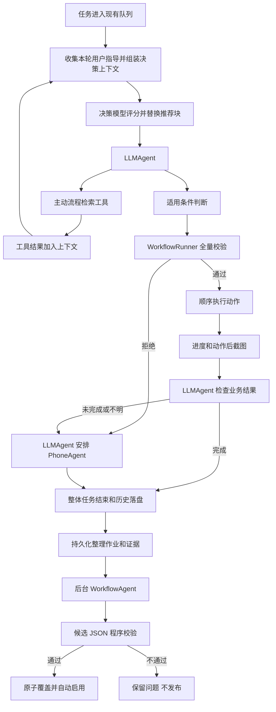

# 可复用手机操作流程 V1 Plan

**版本：** V1（2026-10-14；已合入决策模型推荐层与规划轮次接入讨论）

**Goal：** 将成功手机操作中的稳定片段整理为 JSON，由 LLMAgent 调度确定性执行，并在任务结束后自动生成、修订和维护流程，减少模型调用和人工干预。

**Architecture：** 保留 LLMAgent → PhoneAgent 的现有执行路径，新增规划轮次前的决策模型推荐层、流程检索工具、WorkflowRunner 和任务后的 WorkflowAgent。决策模型聚焦相关候选，LLMAgent 负责适用性判断和业务结果检查，WorkflowAgent 负责证据归纳；程序负责上下文组装、JSON 校验、动作执行、持久化与原子发布。

**Tech Stack：** Android、Kotlin、现有模型客户端与工具调用体系、协程、现有 JSON 能力、现有 JUnit／MockK 测试工具；优先复用，不为 V1 引入额外工作流框架。

**范围：** 本文保存当前方案与后续实施顺序，不代表已实现；本次不修改业务代码、不提交 Git。决策模型的职责、输入和接入时机已纳入 V1；具体服务选型、接口与项目内评分校准仍待确定。

---

## 1. 已确认的产品决策

| 项目 | V1 决策 |
|---|---|
| 生成时机 | 整体任务结束且历史落盘后，启动独立整理 Agent，不在手机执行过程中整理 |
| 自动启用 | 整理后自动启用，不设置人工审批环节 |
| 修改方式 | 旧流程直接覆盖，不要求人工选择版本 |
| 整理范围 | 成功且包含手机操作的任务进入筛选；失败后成功恢复的任务可用于修订 |
| 流程发现 | 每轮 LLMAgent 请求前由决策模型推荐相关流程，同时保留主动检索工具；初始独立相关性得分阈值为 score > 0.5，不代表执行成功概率 |
| 片段边界 | 稳定页面间的短片段；不可重复提交前设置检查边界 |
| 参数 | 仅将真正变化的数量、文本等参数化，输入应明确，不使用模糊的“x 个” |
| 失败处理 | 区分动作失败、业务未完成和结果不明；结果不明时 LLMAgent 安排检查 |
| 环境限制 | 同一设备限定；应用更新后可继续使用，不因版本变化一律禁用 |
| 格式兼容 | 使用前检查完整 JSON；出现无法处理的字段或动作，不执行，告知 LLMAgent，改用 PhoneAgent |
| 修复通知 | 将旧流程问题和本次执行证据交给 WorkflowAgent，整体任务结束后处理 |

## 2. 系统分工

### LLMAgent

- 理解任务，参考本轮自动推荐，必要时通过工具主动检索流程并读取描述。
- 根据当前页面证据确认前置条件；证据不足时安排 PhoneAgent 检查或导航。
- 选择流程、提供参数并调用执行工具。
- 根据动作后新截图及完成指标判断业务结果。
- 未完成或结果不明时安排 PhoneAgent 从当前状态检查、接管，不默认从头重放。

### 决策模型推荐层

- 在每次 LLMAgent 规划请求前，对可用流程的描述进行相关性评分。
- 输入由程序从原始任务、最新计划、近期工具记录、本轮用户指导及流程目录直接组装，不额外调用 LLM 生成摘要。
- 每个流程独立判断是否值得提供参考，允许多个命中和零命中，不使用候选总和为 1 的互斥分类概率套用 50% 阈值。
- 不负责执行授权、业务完成判定、手机操作或流程修改。
- 推荐不可用时不阻塞原有 LLMAgent／PhoneAgent 路径。

### PhoneAgent

- 处理导航、动态页面和不确定步骤。
- 接管流程失败或不适用的任务。
- 提供可供后续整理使用的实际动作与结果证据。

### WorkflowRunner

- 在第一个动作前完成全量 JSON 及参数校验。
- 复用 AgentAction／ActionHandler 顺序执行手机操作。
- 操作层失败立即停止，响应暂停和取消。
- 返回执行进度、具体错误、动作后新截图。
- 不把动作执行成功解释成业务成功。

### WorkflowAgent（流程整理 Agent）

- 整体任务结束后读取不可变执行证据。
- 筛选稳定片段；生成新流程或修订已有流程。
- 没有适合片段时允许不生成，不强制每个任务产出 JSON。
- 只具备读取证据、查询流程、校验、保存与完成整理等工具。
- 不具备手机操作权限，不共享前台 Agent 的状态和取消信号。
- 复用 LLMAgent 的通用模型／工具循环机制，不复制整个业务类。

## 3. 高层执行闭环



任务结束后可以继续处理手机任务队列；后台整理失败不改变原任务结果、不阻塞下一项手机任务。

## 3.1 决策模型推荐层详细设计

### 定位与评分含义

引入快速、非自回归的决策评分能力，用于集中 LLMAgent 对相关流程的注意力，不替代主模型规划。Jev 类模型是选型参考，不在本计划中承诺使用特定服务或达到文章中的延迟、校准效果。

- 评分问题：根据任务和执行进度，这个流程是否值得提供给 LLMAgent 参考？
- 不是判断该流程此刻可执行，也不是预测业务成功率。
- 使用逐流程的相关／不相关评分，不能把所有流程之间的互斥 Softmax 结果当作独立相关性概率。
- 初始采用 `score > 0.5`；没有本项目校准数据前仅称相关性得分，不作“超过 50% 成功概率”的保证。
- 命中后排序并限制候选数量和总 Token；最多 3 个作为建议初值，最终上限可配置。
- 允许零候选，不强制推荐；不能仅向 LLMAgent 开放命中项，保留主动检索作为漏召回补救。

### 接入时机

正常继续执行的每轮顺序：

```text
上一轮 LLMAgent 生成 plan 和 tool 调用
    → 执行 tool
    → 将 ToolResult.Continue 的结果加入上下文
    → 进入下一规划轮次，处理暂停／取消并收集本轮用户追加指令
    → 程序组装决策上下文
    → 决策模型评分，更新本轮推荐块
    → 发起下一次 LLMAgent 模型请求
```

第一轮使用原始任务、当前可用的已知状态和流程目录，无需虚构 plan 或工具结果。任务终止／取消后不评分；推荐请求期间发生取消时不继续发起主模型请求。不要为了生成精确的下一步先调用一次主模型，再推荐，再重新规划。

### 输入生成

由程序从已有结构化状态组装，不新增摘要模型调用。示例中的 recentToolRecords 直接保留原始调用／结果，不从自然语言推断任务完成状态。

```json
{
  "task": "进入蚂蚁庄园，收取鸡蛋，然后捐蛋",
  "latestPlan": "先进入庄园，收蛋，再捐蛋",
  "recentToolRecords": [
    {
      "name": "execute_subtask",
      "arguments": { "description": "打开支付宝并进入蚂蚁庄园主页" },
      "observation": "已进入蚂蚁庄园主页"
    }
  ],
  "knownState": { "page": "庄园主页", "eggCount": null },
  "userGuidance": [],
  "candidates": [
    { "id": "ant_manor_collect_eggs", "description": "在庄园主页收蛋……" },
    { "id": "ant_manor_donate_eggs", "description": "在庄园主页捐蛋……" }
  ]
}
```

- 原始任务：任务输入；latestPlan：上一轮已生成的最新计划，不是尚未生成的下一轮计划。
- recentToolRecords：最近有限轮数的调用参数和原始结果，包含最新工具结果；记录数和长度上限待定。
- knownState：仅传递有来源的已知信息，未知值明确表示未知；本方案不要求为推荐额外调用手机截图或视觉模型。
- userGuidance：本轮已收集的用户指导，向推荐层和主模型传递同一份快照，不能推荐时提前消费导致主模型收不到。
- candidates：流程仓库中可用的 ID、description 及必要的适用元信息；评分阶段不传全部坐标步骤和完整历史。
- 最新计划只作背景，工具结果可能否定计划，不能把计划步骤视为已完成。
- 流程描述和工具结果属于参考数据，不作为可覆盖用户指令的系统指令。

### 提供给 LLMAgent 的内容

默认采用两层载入：自动注入命中流程的 ID、描述和得分；选定后通过工具读取完整流程，或按 ID 调用执行工具。无需每轮注入完整 JSON。

推荐块明确说明：“以下为相关性候选，不代表前置条件已满足，也不要求必须使用。”作为独立辅助上下文，不冒充真实工具结果；每轮替换，不累计追加。无命中或推荐失败时清除旧推荐，不能继续保留过期候选。

进入庄园后可以同时推荐收蛋、捐蛋；LLMAgent 决定先后顺序和适用条件。不要求决策模型精确预测下一项动作。历史已完成片段原则上不反复推荐，但若用户要求重复或当前目标需要，仍可使用；自然语言完成状态不靠程序猜测。

### 缓存、异常与观测

- 输入上下文和流程目录未变化时可复用结果；缓存键涵盖用户指导、计划、近期工具结果、流程目录内容修订及评分配置。
- 流程覆盖、删除或停用使相关缓存失效。推荐到实际执行间发生变化时，执行工具仍重新读取并校验，不信任旧评分授权。
- 初期目录少时评估全部可用描述；目录增大后再考虑粗筛。
- 超时、服务不可用、返回格式／得分非法时跳过推荐，继续主模型；设置推荐耗时预算，不无限重试。
- 推荐层只读流程、无设备权限；模型服务的数据发送范围及隐私策略另行确认。
- 记录推荐耗时、得分、候选采用情况、漏召回及整体任务耗时。不得仅凭命中示例推断效果。
- 测试多项同时相关、完全无匹配、相似流程、候选顺序改变、增加无关候选；模型标称独立评分也需实测候选干扰。

## 4. JSON V1 设计

核心使用自然语言 `description` 加结构化 `steps`。前置条件、用途和完成指标暂不设计复杂规则语言。

描述约定包含：用途、前置条件、操作范围、完成指标、异常处理注意事项。字段名使用 `description`，不是 `discription`。

以下仅展示格式，坐标是占位示例，不是可执行庄园脚本。此例只打开项目，不承诺完成捐赠。

```json
{
  "id": "ant_manor_open_first_donation_project",
  "version": 1,
  "description": "用途：从蚂蚁庄园主页打开当前第一个捐蛋项目。前置条件：当前停留在庄园主页，页面已加载，用户允许选择当前首项。操作范围：打开捐蛋入口，等待并选择首项，不提交捐赠。完成指标：显示该项目的捐赠详情或确认页面。异常处理：未到达目标页面时交给 PhoneAgent 检查当前状态。",
  "steps": [
    { "action": "tap", "x": 500, "y": 700 },
    { "action": "wait", "durationMs": 3000 },
    { "action": "tap", "x": 500, "y": 350 }
  ]
}
```

- 坐标采用现有 0–999 归一化约定，但仅限录制设备，不据此保证跨设备可靠。
- 描述与动作承诺必须一致：遗漏确认步骤时不能宣称已经完成捐赠。
- “首个项目”不等于固定项目，必须符合用户授权的目标选择方式。
- JSON 为受限动作数据，不提供任意 Shell／JavaScript 执行能力。
- `version` 的精确定义、格式版本字段、参数引用语法和设备标识存放位置，在编码前冻结；不能混淆格式版本和内容修订号。
- 参数仅在有实际需要时引入；类型、范围和必填性应由代码校验。

## 5. 校验和运行结果

### 执行前：程序校验

检查完整文件，包括所有步骤及替换参数后的值：

- JSON 语法、必填字段、字段类型。
- 支持的字段、动作与格式版本。
- 非空描述、步骤列表、合法坐标和等待时长。
- 参数绑定是否完整、设备是否匹配。
- 步骤数、总等待等资源上限（数值待定）。

严格拒绝无法处理的字段，不能忽略未知字段或跳过不支持的步骤后继续执行。校验失败必须保证零手机动作，并返回可定位原因。

### 执行前：模型判断

字段合法不等于页面适用。LLMAgent 仍需确认页面、库存、目标项目及应用更新后的布局。应用版本变化可记录为诊断信息，但不直接禁用流程。

### 执行后

工具结果至少包含流程 ID、读取内容的哈希、执行状态、最后尝试步骤、最后成功步骤、错误和动作后截图附件。

```json
{
  "workflowId": "ant_manor_open_first_donation_project",
  "executionStatus": "completed",
  "lastAttemptedStep": 3,
  "lastSucceededStep": 3,
  "error": null
}
```

`completed` 只表示动作序列结束，不表示业务完成。未开始的进度应使用明确空值或约定值，不伪造成功步骤。

业务结果需区分：已完成、未完成、正常不适用、结果不明。执行状态需区分：校验拒绝、动作失败、取消、序列结束。结果不明先核实，不自动整段重试。

## 6. 任务后生成和修订

### 输入证据

- 原始任务、子任务边界与整体结果。
- 每步结构化动作、实际执行结果、动作前后截图。
- 错误、暂停／取消、恢复路径及最终业务证据。
- 设备与应用环境。
- 使用的流程 ID、当时内容快照／哈希、失败步骤。
- 已知的动作及等待时间；未知信息明确标注。

不能直接将历史步骤间时间差当作等待时间：其中含模型推理、网络和截图开销。不能根据完成摘要编造坐标、条件或确认步骤。

### 处理规则

| 证据情况 | 处理 |
|---|---|
| 首次成功且有稳定片段 | 生成流程，程序校验后自动启用 |
| 已有流程成功 | 更新使用／验证记录，通常不重写 |
| 流程失败，PhoneAgent 接管后成功且证明路径变化 | 基于成功证据修订 |
| 确定的格式错误 | 能明确修正则修正，否则保留问题 |
| 执行器不支持某动作 | 仅尝试改写成已支持动作，不能创造执行能力 |
| 未到入口页面、库存不足 | 通常不改点击步骤，必要时完善描述 |
| 一次临时网络超时 | 不据此修改坐标 |
| 结果不明或接管也失败 | 不编造修复；保存问题记录 |
| 用户取消 | 默认不自动生成新流程 |

流程异常发生时登记事件；整体任务落盘后统一整理，不在手机操作中途修改文件。

## 7. 自动发布的工程约束（建议采用，部分细节待确认）

不增加人工审批，但发布仍需确定性校验与成功证据。

1. 原子写入替换，禁止留下半份文件。
2. 执行时读取不可变快照，覆盖不改变已开始的执行。
3. 修订基于旧内容哈希；发布前发生冲突则重新读取，不盲目覆盖较新的内容。
4. 一个当前有效版本即可；建议内部保留一份旧内容备份，回退策略待定。
5. 已确认不可解析或路径失效的流程建议暂时停止被检索选中，修复后自动恢复；普通前置条件不满足不应停用。此规则待最终确认。
6. 发布失败保留旧有效文件，不影响已完成手机任务。

## 8. 后台作业约束

- 整理作业应持久化，应用退出后能够恢复，而非只启动临时协程。
- 保存不可变证据快照，或明确保留相关历史与截图；不能读取会被下一任务替换的 currentTask。
- 作业以任务 ID 和处理版本等作为幂等键，避免重复产出。
- 独立模型客户端实例，避免前台／后台取消请求互相影响。
- 限制后台并发、重试与模型调用成本，手机任务优先。
- 队列实现、调度条件及证据保留期限待后续细化。

## 9. 当前项目接入点

以下为现有相对路径；实际实施前重新核对代码，不依赖固定行号。

| 现有文件 | 用途 |
|---|---|
| `app/src/main/java/com/flowmate/autoxiaoer/agent/LLMAgent.kt` | 在主模型请求前组装决策输入、更新推荐块；接入流程工具，抽取必要的通用运行机制 |
| `app/src/main/java/com/flowmate/autoxiaoer/agent/tools/AgentTool.kt` | 复用工具接口和结果约定 |
| `app/src/main/java/com/flowmate/autoxiaoer/agent/tools/ToolRegistry.kt` | 注册检索、读取和执行流程工具 |
| `app/src/main/java/com/flowmate/autoxiaoer/agent/tools/ToolContext.kt` | 接入依赖、暂停取消及规划轮次 |
| `app/src/main/java/com/flowmate/autoxiaoer/agent/tools/ExecuteSubtaskTool.kt` | 保留 PhoneAgent 回退路径 |
| `app/src/main/java/com/flowmate/autoxiaoer/agent/PhoneAgent.kt` | 补充真实动作执行证据和必要的动作后截图 |
| `app/src/main/java/com/flowmate/autoxiaoer/action/AgentAction.kt` | 复用受支持动作类型 |
| `app/src/main/java/com/flowmate/autoxiaoer/action/ActionHandler.kt` | 复用设备执行底座，核对取消传播 |
| `app/src/main/java/com/flowmate/autoxiaoer/history/HistoryModels.kt` | 必要时扩展证据与流程执行关联 |
| `app/src/main/java/com/flowmate/autoxiaoer/history/HistoryManager.kt` | 历史持久化完成后生成整理输入，考虑清理期限 |
| `app/src/main/java/com/flowmate/autoxiaoer/task/TaskExecutionManager.kt` | 统一设备任务调度和控制 |
| `app/src/main/java/com/flowmate/autoxiaoer/clawbot/ClawBotShortcutHandler.kt` | 保持现有控制职责，不在此承载流程引擎 |

现有细节：

- PhoneAgent 的 onActionExecuted 回调在底层执行前发生，不能据此记录执行成功。
- 历史截图主要是动作前证据，结果检查要采集新截图。
- AgentAction.Batch 当前不是失败立即停止的业务流程执行器，不能直接替代 WorkflowRunner。
- 流程与 PhoneAgent 必须串行使用同一设备执行通道。
- 暂停后页面可能变化，恢复前应重新确认边界；已发送动作不得无条件重放。

## 10. 分阶段实施计划

以下是模块级顺序；未冻结的契约先确认，再拆为具体编码任务。此次只保存计划，不开始实施。

### 阶段 A：冻结契约并建立模型／校验器

建议新增 `app/src/main/java/com/flowmate/autoxiaoer/workflow/WorkflowModels.kt` 和 `WorkflowValidator.kt`。

1. 确定字段集合、版本语义、动作白名单、参数语法、设备标识和资源上限。
2. 先写校验失败用例：未知字段、非法类型、后续步骤不支持、参数缺失、设备不匹配。
3. 实现校验；确保解析任何步骤失败时不会产生设备动作。
4. 增加合法最小流程用例。

### 阶段 B：存储和确定性执行

建议新增同目录 `WorkflowRepository.kt`、`WorkflowRunner.kt`。

1. 先测试原子替换失败保留旧文件、内容快照隔离、哈希冲突。
2. 实现单设备存储与读取。
3. 先测试动作顺序、失败立即停止、等待、取消、暂停恢复和结果未知。
4. 复用 ActionHandler 执行；保证取消不会被转成普通成功或继续执行。
5. 接入逐步日志与动作后截图，区分动作完成和业务完成。

### 阶段 C：决策推荐与 LLMAgent 工具闭环

建议新增 `agent/tools/ExecuteWorkflowTool.kt`、`workflow/WorkflowRecommendationContext.kt` 和 `workflow/WorkflowRecommender.kt`；主动检索与读取工具的具体名称／接口在编码前冻结。

1. 先测试决策上下文组装：第一轮空历史、最新工具结果、有限近期记录、未知状态、本轮用户指导；不得新增摘要模型调用。
2. 用可控评分替身测试多项独立命中、`score > 0.5` 边界、零命中、排序、候选数量／Token 限制和非法返回。
3. 实现只读评分客户端及上下文组装，具体服务选型另定；用替身验证超时和取消，不以真实服务作为单测依赖。
4. 在 LLMAgent 下一轮模型请求前接入推荐；先收集用户指导，确保主模型仍收到同一份指导。
5. 测试推荐块替换而不累计、无命中／失败清除旧块、输入或流程目录变化使缓存失效、结束／取消后不请求推荐。
6. 修改 ToolRegistry／ToolContext，暴露主动检索、读取和执行所需能力；推荐为空或不可用时仍能检索和使用 PhoneAgent。
7. 测试执行结果、错误、动作后截图正确返回给 LLMAgent；修改提示词强调相关性不等于可执行性或业务成功。
8. 用代表性任务实测召回、采用率、顺序／无关候选干扰、推荐延迟与总任务耗时，再调整阈值和预算。

### 阶段 D：完整证据和后台队列

建议新增 `workflow/WorkflowEvidence.kt`、`WorkflowCurationQueue.kt`。

1. 先测试历史落盘后才入队、重复事件幂等、退出恢复和证据保留。
2. 打通各整体任务结束路径；子任务完成不独立触发整理。
3. 保存实际使用流程快照和恢复记录。
4. 确保后台失败不改变前台结果，不重复推进手机任务队列。

### 阶段 E：WorkflowAgent 自动整理与发布

建议新增 `agent/WorkflowAgent.kt`；仅在确有共性时抽取通用运行核心。

1. 为前台 LLMAgent 的现有行为增加回归测试。
2. 为整理 Agent 提供独立上下文、模型客户端和受限工具。
3. 用固定执行记录测试稳定片段提取、纠错步骤剔除、描述与动作一致性。
4. 测试成功恢复修订、缺证据不发布、临时网络问题不乱改。
5. 通过校验后自动覆盖启用；保留诊断信息。

### 阶段 F：端到端验证和相关说明

1. 同设备手动验证：入口不符、弹窗、慢加载、无蛋／库存不足、应用更新。
2. 验证不可重复操作结果不明时先检查，不整段重放。
3. 验证暂停恢复、停止、下一任务执行、后台同时整理互不干扰。
4. 核对真实成功路径生成的流程，不能使用本文占位坐标。
5. 更新直接相关的用户说明和开发说明，不扩展无关功能。

## 11. 验收与验证命令

使用现有测试工具，优先运行新增模块和受影响 Agent 的定向测试。测试类名为建议命名，创建后再运行。

```powershell
.\gradlew.bat :app:testDebugUnitTest --tests "com.flowmate.autoxiaoer.workflow.*"
```

预期：校验、存储、执行、整理队列测试全部通过。Agent 修改后追加对应实际测试类选择器；只有定向测试需要时才升级至较大范围。

必要的 Android 编译验证：

```powershell
.\gradlew.bat :app:compileDebugKotlin
```

预期：编译成功。文档保存阶段不运行编译和测试。

关键验收：

- 无法处理的 JSON 在零手机动作前被拒绝。
- 操作失败后无后续点击，结果不明不自动重复提交。
- 暂停、取消和串行设备控制覆盖流程执行路径。
- 已开始执行不受文件覆盖影响。
- 整理后自动启用，修订原子覆盖，无人工审批要求。
- 无成功证据时不编造动作或宣称已验证。
- 应用更新不强制禁用，但使用前仍检查页面适用性。
- 整理作业独立、可恢复、幂等，不干扰前台模型请求。
- 每轮推荐位于工具结果进入上下文及用户指导收集之后、主模型请求之前；首轮和终止路径正确处理。
- 多个流程可独立超过阈值，也允许零候选；得分不被解释为执行成功概率。
- 推荐内容每轮替换，不伪造工具结果、不重复堆积；用户指导同时到达推荐层和主模型。
- 推荐超时、格式错误或无命中不阻塞原有路径，清除旧推荐，保留主动检索。
- 上下文／流程目录变化使缓存失效，记录候选采用情况及总延迟。

## 12. 留待后续讨论

1. 决策模型具体服务／部署方式、评分接口、数据发送范围、项目内校准方法；初始阈值 0.5 已定为可配置初值，候选上限、上下文预算、超时和缓存细节待冻结。
2. JSON 精确契约：版本、参数替换、设备标识、动作白名单和上限。
3. 提交前检查边界：分成两个流程，还是明确的检查节点；V1 优先短片段，不先做复杂引擎。
4. 已知失效流程的临时停用、内部备份和冲突后的重整策略。
5. 后台队列实现、网络／电量策略、Token 预算、证据保留与隐私脱敏。
6. 流程列表、停用／删除、诊断入口是否进入 V1；不增加必需的人工审核。

这些事项未确定前，不应擅自补充为已批准需求。
